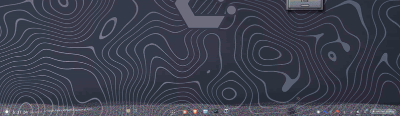
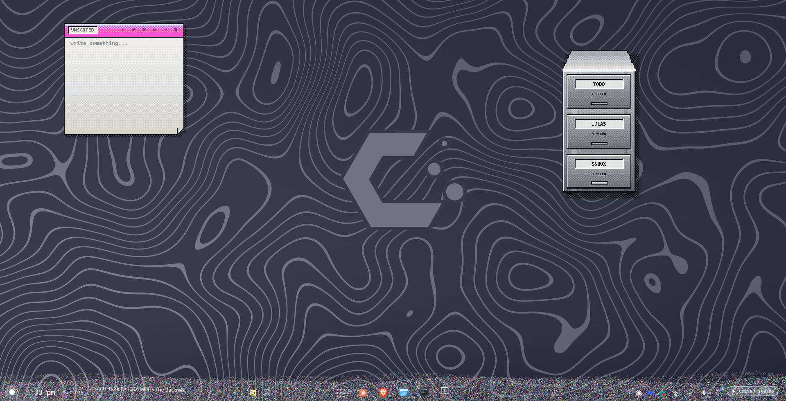
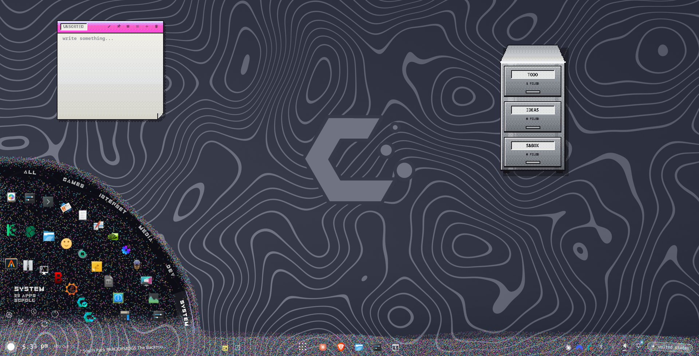
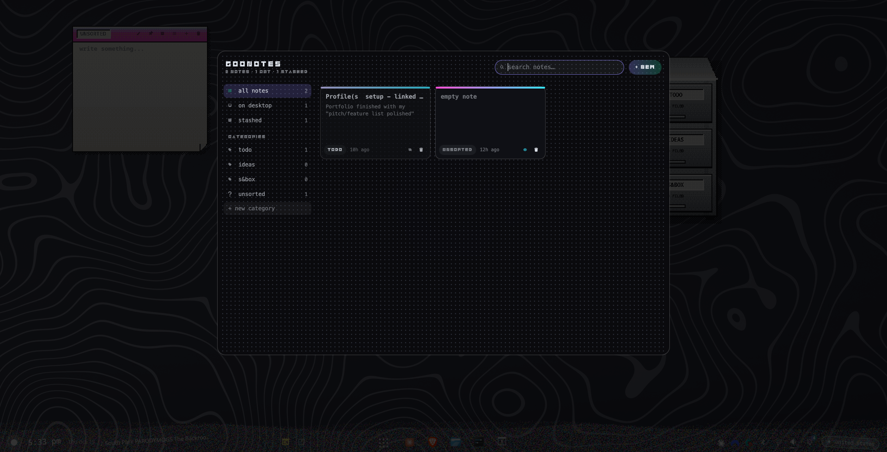

# wavegoo

A custom desktop shell for **KDE Plasma (Wayland)**, built from scratch in [Quickshell](https://quickshell.outfoxxed.me/) (QML + GLSL), plus **goonotes**, a sticky-notes app with a pixel-art file cabinet.





## wavegoo: the bar

- **The bar is a physics simulation.** It's a strip of square dots, each one a mass on a spring coupled to its neighbours like a membrane. Your cursor plows through them, pushes ripple outward and settle, and clicks send shockwaves. The sim runs on a coarse grid in JS, writes offsets into a tiny texture, and a fragment shader draws the dots on the GPU. It sleeps when idle, so a still bar costs nothing.
- **Liquid gradient + "sand" grains** (magenta / cyan / yellow) that move with the bar's wave.


- **Start menu as an arc fan** that unfolds out of the start orb: category carousels on three rings, search in the hub, and a power cluster (lock / sleep / log out / restart / shut down).
- **Task list via a KWin bridge** (`windows.py`). KWin doesn't give Wayland clients a window list, so a small KWin script pushes it over D-Bus. Also handles Meta+1..9 and the bare Super key.
- **Pinned-app drawer** that grows up out of the dots, with right-click pin/unpin saved to state.
- Status icons (volume via PipeWire, network, Bluetooth, notifications), media (MPRIS), system tray, and a calendar popup.
- **Custom font:** `fonts/roundsquare.py` generates *Wavegoo Roundsquare* procedurally. Every glyph is a solid block with round holes, slits and notches cut out of it.

## goonotes: sticky notes + file cabinet



- Dot-matrix sticky notes that live on the desktop in wavegoo colours.
- **A steel file cabinet drawn like Amiga AGA pixel art**: a fixed palette, chunky pixels, and ordered dithering done in a shader (`shaders/aga.frag`). Each drawer is a category. Drag a note over the cabinet and the drawers crack open, then drop it in to file it. Hover a drawer and it slides out with notes standing up like folders.
- A notes drawer to search, filter, re-file, stash and delete notes.
- IPC: `qs -c goonotes ipc call notes add | drawer | toggle | pinAll | unpinAll | quit | list`
- **Phone sync (in progress):** a sync server keeps goonotes in step with an Android app, using per-note last-write-wins merging, conflict copies and tombstones.

## Install

Requirements: KDE Plasma 6 on Wayland, `quickshell`, `python-gobject`, `networkmanager` (nmcli), `qt6-tools` (qdbus6). Optional: `swaync`, `cava`.

```sh
git clone https://github.com/themightypooh/wavegoo
cd wavegoo
./install.sh      # symlinks into ~/.config, backs up anything already there
qs -c wavegoo     # the bar
qs -c goonotes -d # notes (daemonized)
```

`install.sh` also adds an autostart entry for the bar. Colours and default pins are at the top of `quickshell/wavegoo/shell.qml`.

Tip: hide or remove the stock Plasma panel so the bar doesn't sit on top of it.

## Layout

```
quickshell/wavegoo/    the bar, start menu, KWin bridge, shaders, font generator
quickshell/goonotes/   sticky notes, cabinet, AGA dither shader
alacritty/             terminal config
autostart/             launches the bar on login
```

## License

MIT. See [LICENSE](LICENSE).
